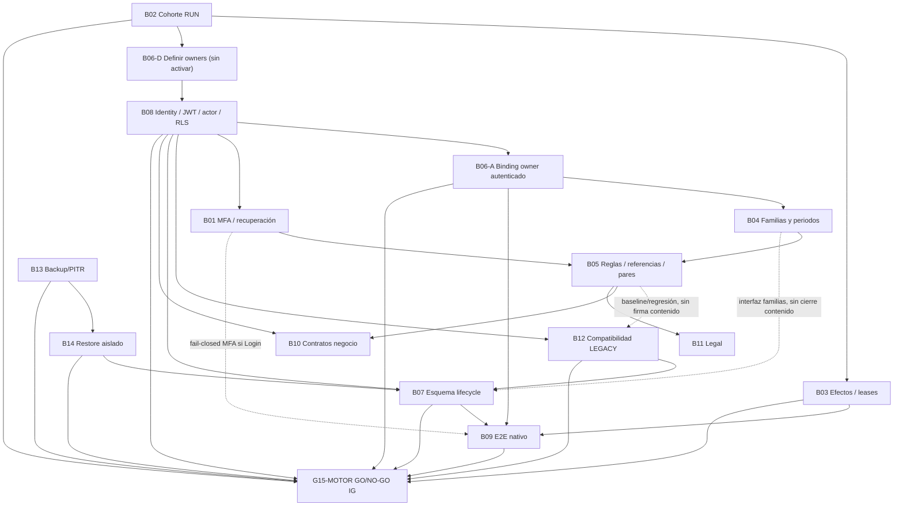

# Camino crítico de cierre — sin cronograma ni fechas inferidas

**Convención:** A → B indica dependencia de evidencia. En el mismo grupo exige cierre precedente; **Contenido → Motor exige validar contrato técnico/interfaz o contención fail-closed, no la firma ni cierre documental integral de Contenido**. Los 14 bloqueos subsisten y sus requisitos de cierre originales no se rebajan. No se libera una funcionalidad de Contenido hasta cumplir sus propios gates. Algunos trabajos documentales pueden avanzar en paralelo. La matriz fuente L21 no se modifica.

## Flujo de dependencias

**B06 ↔ B08, circularidad original:** L21 indica B06 depende de B08 para ejecución y B08 depende del contrato owner B06. Descomponer solo el **trabajo de definición** en B06-D (acta nominativa, actor propuesto, proyecto, familia y alcance sin escritura), B08 (validación identidad y autorización real), B06-A (binding/auth readback + pruebas negativas). **B06 cierra únicamente al final de B06-A**, sin suprimir el requisito de B08. Esto es una propuesta de planificación, requiere aceptación de Arquitectura/IAM/dueño, no es cambio contractual.

## Cadenas de trabajo sin plazos ficticios
**Motor (9):** B02, B03, B06, B07, B08, B09, B12, B13, B14. **Contenido (5):** B01, B04, B05, B10, B11. Solo Motor decide pase técnico de IG. Las firmas de Contenido se registran por IG en paralelo y no son requisito de GO de Motor.
1. **Contención RUN:** B02 → B03. Congelar 232/32 IDs y reconciliar *uno por uno*; no cerrar ni reintentar a ciegas.
2. **Confianza y autorización:** B06-D → B08 → B06-A → B04 → B05; B08 → B01 (MFA). B05 requiere B01 para la referencia MFA.
3. **Protección previa a cambio:** B13 → B14; en paralelo B08 + contrato/baseline de B05 → B12. B07 exige la **interfaz técnica de B04** junto a B08+B12+B14, no las 15/23 firmas de Contenido. Nunca ejecutar DDL dentro de este lote.
4. **Validación integrada:** B03+B06-A+B08+B07 → B09; si el caso toca Login, demostrar comportamiento **fail-closed** de B01 sin exigir su promoción/firma integral. Si la ruta de autenticación no es segura, **B09 no cierra**. Probar ruta oficial y 11 pasos solo en operación posterior aprobada.
5. **Contenido paralelo por IG:** B08+B05 → B10 (contratos, permisos, pruebas); B05 → B11 (textos y aceptación legal); B08→B01; B06→B04→B05. Sus firmas y aprobaciones documentales son necesarias para sus propias publicaciones/operaciones, **no para G15-MOTOR**. No habilitar pagos, Login condicionado a MFA no aprobado, recovery ni reclamaciones pendientes como funcionalidades productivas.
6. **Pase técnico IG:** cerrar 9 bloqueos Motor con evidencia y recibos autenticados + nueve gates Motor → G15-MOTOR (dueño/autoridad de despliegue, riesgo, rollback y operación futura separada). Los 5 cierres de Contenido se mantienen en tablero propio; **no se exigen para este GO técnico**. El criterio original G15 de L21 se preserva como fuente histórica no modificada; la aplicación práctica del nuevo alcance requiere aceptación gobernada.

## Barreras adicionales que no son bloqueos nuevos
- **RBAC ausente según dueño, pendiente de readback:** permiso de mantenimiento de pricing (B10/B08), reenvío de cartas (B10/B11/B08), aprobación de recuperación (B01/B10/B08), edición de parámetros de riesgo (B05/B10/B08). Sin diseño, creación gobernada posterior, binding perfil-permiso, tests deny-by-default y audit trail no hay cierre del bloqueo relacionado.
- **Proveedor SMS contingencia no confirmado:** B01; no inventar proveedor, esquema ni SLA. OTP Brevo correo debe probar entrega y validación server-side; correo solo no acredita AAL2 de forma automática.
- **Asuntos NO_DEFINIDOS:** disparadores MFA adicionales; reintentos, recordatorios, mora y destino contable del incobrable; intervalos LF/SALY de revisión; contratos definitivos con aliados y proveedor IDV.
- **Datos de muestra Q08–Q11:** sirven para desarrollo sin publicación, no satisfacen gates productivos.
- **Segregación LF/SALY:** propietarios, reglas, familias y periodos no se presuponen comunes.

## Condiciones por bloqueo — orden de cierre, no prioridad de implementación
| ID | Entradas de cierre obligatorias | Salida que habilita |
|---|---|---|
| B02 | Cohorte literal + firma dueño/Operaciones | B03 y determinación de alcance B06-D |
| B03 | B02 + reconciliación por RUN, leases, idempotencia | B09 |
| B06 | Nombramiento B06-D + B08 + binding y pruebas B06-A | B04 y B09 |
| B08 | Contrato owner B06-D; JWT y sub reales, RLS/GRANT | Activación B06-A, B01, B12, B07, B10 |
| B01 | B08 + MFA fail-closed + proveedor y negativos | Contenido: B05; B09 usa control fail-closed si Login, sin firma B01 |
| B04 | B06 + 15 familias/23 casos/intervalos LF y SALY | Contenido B05; Motor B07 necesita contrato/interfaz familias sin aprobar 15/23 |
| B05 | B04 + B01 para MFA, 57/3/20 dictaminados | Contenido B10/B11; Motor B12 necesita baseline/contrato y regresión (no cierre B05) |
| B12 | B08 + baseline/compatibilidad B05 (sin cierre ni firma B05), regresión de 4 funciones/gates intactos | Motor B07 |
| B13 | RPO/RTO, backup físico, PITR y custodia reales | B14 |
| B14 | B13 + restauración real aislada | B07 |
| B07 | Contrato/interfaz B04 (sin cierre B04) + B08+B12+B14 y plan migración reversible | Motor B09 |
| B09 | B03+B06+B08+B07; controles B01 fail-closed si Login; prueba nativa firmada | G15-MOTOR |
| B10 | B08+B05, proveedor/pagos/ledger/pricing/IDV/aliados y permisos | Publicación funcional propia de Contenido (no G15-MOTOR); B09 antes de operar |
| B11 | B05, legal/consentimientos/visuales/mora versionados | Publicación funcional propia de Contenido (no G15-MOTOR) |

**Riesgo de interpretación:** separación de gates ≠ bypass. Una falla de contrato, aislamiento, autenticación, regressión o fail-closed **sí bloquea B07/B12/B09 según corresponda**, aunque la firma documental de Contenido no sea un gate. La secuencia es propuesta, sin evidencias nuevas ni fechas inventadas.

