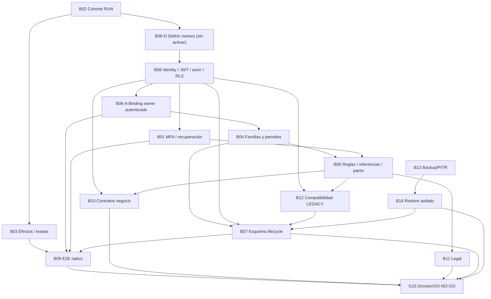

# Camino crítico de cierre — sin cronograma ni fechas inferidas

**Convención:** A → B significa que B no puede cerrarse sin evidencia aceptada de A. Algunos trabajos documentales pueden comenzar antes, **pero no cerrar ni activar**. La secuencia proviene de L21, con una resolución explícita de la circularidad B06/B08, que se conserva como problema de diseño a validar.

## Flujo de dependencias

**B06 ↔ B08, circularidad original:** L21 indica B06 depende de B08 para ejecución y B08 depende del contrato owner B06. Descomponer solo el **trabajo de definición** en B06-D (acta nominativa, actor propuesto, proyecto, familia y alcance sin escritura), B08 (validación identidad y autorización real), B06-A (binding/auth readback + pruebas negativas). **B06 cierra únicamente al final de B06-A**, sin suprimir el requisito de B08. Esto es una propuesta de planificación, requiere aceptación de Arquitectura/IAM/dueño, no es cambio contractual.

## Cadenas de trabajo sin plazos ficticios
1. **Contención RUN:** B02 → B03. Congelar 232/32 IDs y reconciliar *uno por uno*; no cerrar ni reintentar a ciegas.
2. **Confianza y autorización:** B06-D → B08 → B06-A → B04 → B05; B08 → B01 (MFA). B05 requiere B01 para la referencia MFA.
3. **Protección previa a cambio:** B13 → B14; en paralelo B08+B05 → B12. Ambas confluyen con B04 en B07. Nunca ejecutar DDL dentro de este lote.
4. **Validación integrada:** B03+B06-A+B08+B01+B07 → B09; depende de comprobar ruta oficial y registro de 11 pasos en la operación posterior aprobada.
5. **Negocio y legal:** B08+B05 → B10 (contratos, permisos, pruebas); B05 → B11 (textos y aceptación legal). Su preparación puede solaparse; no pasar a operación/liberación sin B09 y G15.
6. **Decisión final:** B01..B14 cerrados con recibos auténticos + G01..G14 acreditados → G15 (dueño, firmante autenticado, alcance, rollback, autorización futura separada).

## Barreras adicionales que no son bloqueos nuevos
- **RBAC ausente según dueño, pendiente de readback:** permiso de mantenimiento de pricing (B10/B08), reenvío de cartas (B10/B11/B08), aprobación de recuperación (B01/B10/B08), edición de parámetros de riesgo (B05/B10/B08). Sin diseño, creación gobernada posterior, binding perfil-permiso, tests deny-by-default y audit trail no hay cierre del bloqueo relacionado.
- **Proveedor SMS contingencia no confirmado:** B01; no inventar proveedor, esquema ni SLA. OTP Brevo correo debe probar entrega y validación server-side; correo solo no acredita AAL2 de forma automática.
- **Asuntos NO_DEFINIDOS:** disparadores MFA adicionales; reintentos, recordatorios, mora y destino contable del incobrable; intervalos LF/SALY de revisión; contratos definitivos con aliados y proveedor IDV.
- **Datos de muestra Q08–Q11:** sirven para desarrollo sin publicación, no satisfacen gates productivos.
- **Segregación LF/SALY:** propietarios, reglas, familias y periodos no se presuponen comunes.

## Condiciones por bloqueo — orden de cierre, no prioridad de implementación
| ID | Entradas de cierre obligatorias | Salida que habilita |
|---|---|---|
| B02 | Cohorte literal + firma dueño/Operaciones | B03 y determinación de alcance B06-D |
| B03 | B02 + reconciliación por RUN, leases, idempotencia | B09 |
| B06 | Nombramiento B06-D + B08 + binding y pruebas B06-A | B04 y B09 |
| B08 | Contrato owner B06-D; JWT y sub reales, RLS/GRANT | Activación B06-A, B01, B12, B07, B10 |
| B01 | B08 + MFA fail-closed + proveedor y negativos | B05 / B09 |
| B04 | B06 + 15 familias/23 casos/intervalos LF y SALY | B05, B07 |
| B05 | B04 + B01 para MFA, 57/3/20 dictaminados | B12, B10, B11 |
| B12 | B08+B05, regresión de 4 funciones/gates intactos | B07 |
| B13 | RPO/RTO, backup físico, PITR y custodia reales | B14 |
| B14 | B13 + restauración real aislada | B07 |
| B07 | B04+B08+B12+B14 y plan migración reversible | B09 |
| B09 | B03+B06+B08+B01 (Login)+B07; prueba nativa firmada | G15 |
| B10 | B08+B05, proveedor/pagos/ledger/pricing/IDV/aliados y permisos | G15; B09 antes de operar |
| B11 | B05, legal/consentimientos/visuales/mora versionados | G15 |

**Riesgo de interpretación:** la secuencia es propuesta de cierre, no una afirmación de que dependencias hayan sido satisfechas. El orden de trabajo puede ser paralelo; la aceptación final no.

