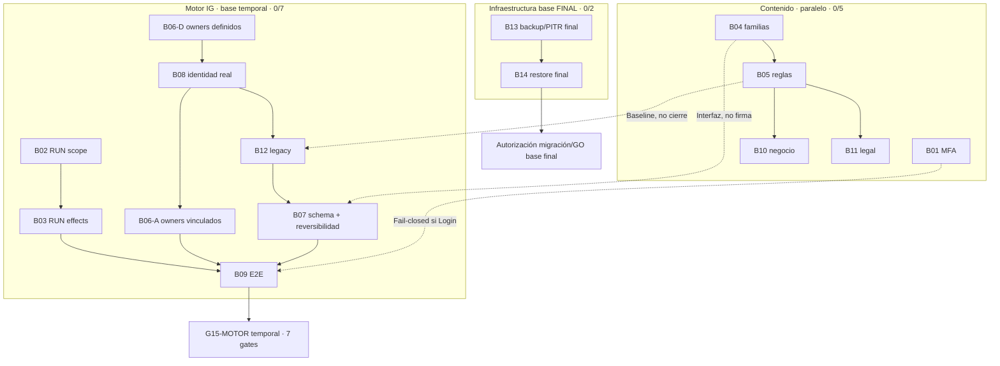

# Camino crítico L28 — sin fechas ni ejecución

**Tres carriles:** Motor TEMPORAL B02/B03/B06/B07/B08/B09/B12; Contenido B01/B04/B05/B10/B11; Infraestructura FINAL B13/B14. Las aristas son dependencias técnicas; ninguna firma de Contenido bloquea per se el pase técnico de IG.

## Orden por dependencia
1. Motor: B02→B03; en paralelo B06-D→B08→B06-A; B08 + baseline B05→B12; B12 + B08 + interfaz B04→B07; todos confluyen en B09.
2. Contenido: B08→B01 y B06→B04→B05→B10/B11. Avanza por IG con pruebas de muestra cuando corresponda; sin firmas de Contenido exigibles para G15-MOTOR.
3. Base temporal: antes de cada cambio, **preimagen SHA del objeto/fila afectado, fuente, actor, scope, diff, plan de reversión y readback**. Si el cambio no es revertible o compromete datos/RUN, bloquear. La decisión excluye contratar PITR o crear proyecto Supabase de prueba.
4. Infraestructura final: B13 evidencia real y política PITR/RPO/RTO→B14 restauración aislada real→autoridad de migración final; incluye revalidación del esquema B07 en destino. **No depende del GO técnico del motor temporal** y no lo bloquea.
5. G15-MOTOR temporal: solamente G01/G02/G03/G04/G08/G11/G12 y recibos B02/B03/B06/B07/B08/B09/B12; sin GO de Contenido ni Infraestructura final. Contrato desplegado debe ser verificado/ajustado por vía oficial antes de usarlo.

## Dependencias preservadas (sin cierres ficticios)
| ID | Entrega técnica / condición | Habilita |
|---|---|---|
| B02 | Universo/cohorte literal 232/32, firma de autoridad Motor, no modificar RUN | B03 |
| B03 | Recon por RUN, workers y efectos, preimágenes, sin cerrar/reintentar | B09 |
| B06 | Owner LF/SALY de proyecto+familia y sub real, no SUPER_ADMIN tácito | B09 / B04 |
| B08 | JWT Auth real, RLS, roles efectivos y negativos | B06-A / B12 / B07 / B01 |
| B12 | Cuatro funciones legacy, baseline B05 técnico, MD5 y regresión | B07 |
| B07 | LF4/SALY5, interfaz B04, rollback y hashes preimagen por cambio | B09 |
| B09 | E2E nativo, Step70, firmas/recibos, B01 fail-closed si Login | G15-MOTOR |
| B01 | MFA, proveedores y recuperación sin bypass | B05 y Login contenido; control fail-closed en B09 |
| B04 | 15 familias + 23 adscripciones + periodos pendientes | B05; interfaz B07 sin cierre B04 |
| B05 | 57/3/20 dictámenes; no igualar parámetros | B10/B11; baseline B12 sin firma B05 |
| B10 | Niubiz, payment/payment_detail, pricing, carta y permisos | Publicación de negocio posterior |
| B11 | Legal, consentimientos, mora y claims | Publicación de contenidos posterior |
| B13 | **Base final**: backup físico/PITR con IDs, política y custodia; panel temporal solo evidencia referida | B14 en destino final |
| B14 | **Base final**: restore aislado real, integridad, RPO/RTO medidos | Autorización futura de migración final |

**Fuente histórica L21 intacta:** en su matriz B13→B14→B07 aplica a una liberación productiva plena; en L28 la revalidación de B07 **al migrar a la base final** mantiene ese orden, pero se saca de la fórmula del pase **temporal**. No se declara irrelevante la continuidad.
