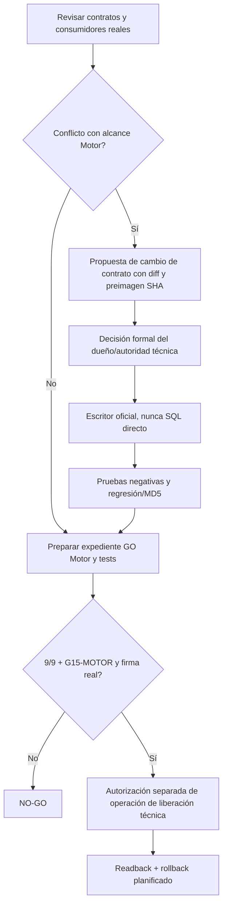

# L28 — Especificación CANDIDATA de G15-MOTOR (NO APLICAR)

**Propósito:** que la decisión de pase **técnico** de Input Governance considere únicamente los **9 bloqueos de MOTOR**, sin exigir firma/cierre de los 5 bloqueos de CONTENIDO; preservar rutas oficiales, funciones congeladas y el bloqueo de `production_promotion` de ejecución ordinaria IG.

## Límites de autoridad
- Esta propuesta **NO declara que exista un gate `G15-MOTOR` desplegado**.
- El G15 de L21 permanece **fuente documental histórica no editada**. No reescribir ni reinterpretar recibos ya firmados: no hay tales recibos acreditados.
- No se modifica `EJECUCION_INPUT_GOVERNANCE_LF`, ni se quita su bloqueo `production_promotion`. El mecanismo futuro de **liberación técnica del motor** debe estar separado de la **promoción de contenido de reglas**, y aprobado por autoridad identificada.
- No modificar RUN preexistentes; identidad Supabase Auth real, B06 owners, B08 RLS y B09 E2E deben estar verificados antes de GO. Sin service_role en Router/prompts.
- **No ejecutar DML/DDL** ni cambios de funciones/contratos en este lote.

## 1. Contrato conceptual propuesto: `IG_MOTOR_RELEASE_GATE_V1`

| Campo conceptual | Valor / regla |
|---|---|
| `scope` | `INPUT_GOVERNANCE_MOTOR_ONLY`; proyectos y runtime exactos firmados |
| `required_blockers` | `[B02_RUN_SCOPE,B03_RUN_EFFECTS,B06_OWNER,B07_SCHEMA,B08_IDENTITY,B09_E2E,B12_LEGACY,B13_BACKUP,B14_RESTORE]` |
| `required_gates` | `[G01,G02,G03,G04,G08,G09,G10,G11,G12]` |
| `release_authority` | Identidad real del actor autorizador + scope/proyecto, segregada de SUPER_ADMIN y escritor oficial, por acreditar |
| `receipt_validation` | 9 recibos verificados con identidad/sub, hash, raw y readback; G15-MOTOR con autorización separada |
| `content_gates_excluded_from_motor` | `[G05,G06,G07,G13,G14]`; **solo no veto** al GO del motor |
| `cross_group_technical_requirements` | B04→B07 interfaz familias, B05→B12 baseline/legacy, B01→B09 fail-closed si Login |
| `content_release_policy` | Las funcionalidades con bloqueos de Contenido siguen CANDIDATO/NO_PUBLICADAS/DESHABILITADAS según contrato hasta validación propia |
| `decision` | `GO_MOTOR_LIMITADO`, `NO_GO_MOTOR` o `INCONCLUSO`; `INCONCLUSO = no desplegar` |
| `output` | Recibo firmable del gate de Motor, alcance, evidencia, riesgo residual, operación posterior permitida, reversión y readback |
| `no_implicit_side_effects` | No promueve reglas, no activa pagos/MFA, no concede permisos ni cierra RUN |

## 2. Evidencia mínima por gate

- B02/B03: cohorte RUN exacta, preimage y reconciliación por RUN, sin tocar los existentes.
- B06/B08: owners con actor/sub y proyecto real, permisos RLS/GRANT, no SUPER_ADMIN como aprobador tácito, positivos/negativos.
- B07: modelo lifecycle LF 4/SALY 5, RLS y rollback post-datos; **interfaz familia probada**, sin exigir 15+23 dictámenes firmados.
- B12: compatibilidad de cuatro funciones legacy sobre baseline de reglas existentes, MD5 intactos, **sin exigir 57/3/20 firmas**.
- B09: ACT-0001→Perfil→RUN→IG→Step70/registro→terminal, autenticación y negativos. Si incluye Login, MFA no aprobado **fail-closed**, jamás omitido.
- B13/B14: backup físico/PITR y restauración real en aislamiento con RPO/RTO.
- G15-MOTOR: 9/9 + 9 gates, autoridad comprobada, plan de despliegue técnico separado, sin contenidos indebidamente habilitados.

## 3. Evals de regresión (propuestas, no ejecutadas)

| ID | Caso | Esperado |
|---|---|---|
| R01 | Motor 9/9 con firmas y readbacks válidos; Contenido 0/5; funciones Contenido bloqueadas | GO_MOTOR_LIMITADO **solo con autoridad y operación posterior aprobadas** |
| R02 | Motor 8/9; Contenido 5/5 | NO_GO_MOTOR |
| R03 | Motor 9/9 pero JWT/sub no validado o SUPER_ADMIN implícito | NO_GO_MOTOR |
| R04 | Motor 9/9, B01 MFA pendiente, caso Login intenta obtener AUTHENTICATED sin MFA | NO_GO_MOTOR / NEGATIVO_FAIL_CLOSED |
| R05 | Motor 9/9, B04 familias pendiente; schema B07 no cumple 47_FAMILIES_PER_ACTIVE_SCREEN / 47_VALIDATOR_PASS aplicables | NO_GO_MOTOR |
| R06 | Motor 9/9, B05 pendiente; cambio legacy causa degradación de controles existentes | NO_GO_MOTOR |
| R07 | Motor 9/9 con contenido B10/B11 no aprobado; intento de publicar precio, carta, cobro o claims | BLOQUEAR publicación funcional; **no reetiquetar resultado GO como autorización de esas funciones** |
| R08 | Motor completo, fuente de backup sin restore real | NO_GO_MOTOR |
| R09 | Llamada directa a `EJECUCION_INPUT_GOVERNANCE_LF` para `production_promotion` | BLOQUEAR conforme contrato vigente |
| R10 | Un RUN histórico cambiado, o gate MD5 congelado alterado | NO_GO_MOTOR y detener |
| R11 | Firma/recibo vacío, texto sin hash, juez sin identidad o firma solo conversacional | NO_GO_MOTOR |
| R12 | Motor completo pero consumer externa exige G15 global y no se ha reconciliado | NO_GO_MOTOR hasta resolución oficial; no usar bypass |

## 4. Camino oficial de cambio futuro

**Pendiente crítico:** verificación completa de rutas de release/consumers, y definición de autoridad de escritor/owner; la lectura SQL de L28 `08_readback_live_release_scope.md` no puede acreditarlo sola.

**Dictamen:** `SPEC_CANDIDATA_NO_APLICAR`. Ningún RUN ni regla cambia por este documento.

