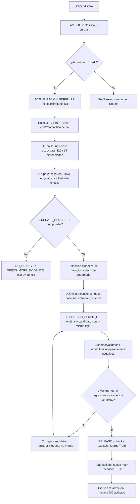

# LF — ACTUALIZACION_PERFIL_LF | README operativo

**Estado del documento:** guía de operación y diagnóstico, no autorización de producción.
**Fuente de autoridad:** Supabase vivo (operación, pasos, política `POL-PROFILE-UPDATE-PASS`, ejecución y juez). Este README describe el funcionamiento comprobado del código GitHub y de las consultas; **si discrepa con la política activa, prevalece el snapshot Supabase de la ejecución**.
**Actualizado:** 2026-10-30. No contiene valores de perfiles/owners hardcodeados como regla general.

## 1. ¿Qué hace y quién es responsable?

- **Router ACT-0001:** clasifica la solicitud y deriva la acción `PROFILE_UPDATE` hacia `ACTUALIZACION_PERFIL_LF`; no ejecuta ni modifica el perfil.
- **Perfil reparador (`systemic_root_cause_repair_lf`):** cuando una solicitud se refiere a crear/reparar/evolucionar otro perfil, identifica el problema y retorna el handoff gobernado; no reemplaza el actualizador ni se concede permisos.
- **Actualizador de perfiles:** mide el estado actual, decide si la evolución está justificada, determina métodos de forma dinámica, crea el candidato completo, lo prueba, somete el cambio al Train y hace readback. Puede **agregar, sustituir o retirar** pasos según evidencia y contrato; no obliga a todos los perfiles a tener pasos idénticos.
- **`EJECUCION_PERFIL_LF`:** ejecuta realmente el perfil original y el evolucionado sobre el **mismo caso literal** y conserva su RAW. No confundir admisión del Router ni compilación de prompts con ejecución efectiva.
- **Juez semántico independiente y comparador confiable:** contrastan lo demostrado; un validador estructural nunca sustituye el juez ni la atestación del productor.
- **Merge Train:** integra solo un PR apto; el cierre requiere readback en `main`. Activar runtime es otra operación gobernada.

## 2. Flujo de extremo a extremo



### Etapas gobernadas (versión vigente = snapshot, no numeración visual)

| Fase | Paso / evidencia principal | Condición para continuar |
| --- | --- | --- |
| Admisión | `init_execution`, Router, `profile_resolve` | Identidad exacta y política inmutable |
| Diagnóstico | `baseline_read`, **35 `method_selection`**, **37 `evolution_decision`** según ruta registrada | Métodos elegibles o vacío justificado; decisión UPDATE/NO_CHANGE/NEEDS_MORE_EVIDENCE |
| Diseño | `change_scope`, `regression_plan` | Qué cambia, qué se conserva y qué se falsifica |
| Pre-escritura | `pre_write_execution_binding_gate` | Vínculo ejecución ↔ target ↔ HEAD exacto |
| Candidato | `github_write`, `github_readback` | Solo paths autorizados; nuevo HEAD legible |
| Calidad | `deterministic_validation`, `semantic_judge`, `regression_after` | Prueba real, límites y 0 regresiones |
| Integración | PR, checks PASE, Merge Train | Releer `main` + política antes de merge |
| Cierre | `post_merge_reconcile`, `close`, `report_output` | Árbol idéntico y evidencia de estado final |

**Nota:** el paso **37** de decisión de evolución no es el comparador operacional Grupo 2. El grupo operacional se verifica sobre los árboles exactos antes de aceptar el pase. Verificar el orden y presencia real de pasos en `lf_operation_step_contracts` y el snapshot de **cada ejecución**, no en esta tabla.

## 3. Requisitos mínimos antes de actualizar

1. Un **perfil objetivo exacto** (`PERFIL-...` + `profiles/<slug>/`), y solicitud literal. No actualizar todos los perfiles por un mismo despacho sin selección/admisión individual.
2. Contrato actual, lista de pasos, EKB, política `POL-PROFILE-UPDATE-PASS` y su SHA consultados desde Supabase. No usar un PR previo como autoridad.
3. El árbol y `main` **congelados por SHA**; ningún valor de búsqueda o owner puede darse por inferido.
4. Diagnóstico real: caso reproducible en `skills/profile_creator/operational_cases/<slug>/<CASE>.case.json`; salida completa del perfil base y candidato, ambas del **mismo input**, validadas y registradas bajo el `profile_tree_sha256` exacto.
5. Pruebas positivas, negativas, regresiones, fail-closed y revisión semántica independiente cuando la política activa lo exige. Documentar limitaciones de `GPT_NATIVE` en el mismo chat: `UNATTESTED` **no** equivale a un recibo de proveedor.
6. Estado de ejecución existente: **buscar `IN_PROGRESS` antes de crear una nueva**; examinar su política congelada, HEAD de anclaje y últimos pasos. Una ejecución antigua no se reancla silenciosamente si `main` avanzó.
7. Pre-write binding válido y controles PASE del commit exacto. No forzar merge, cambiar el comparador para pasar, alterar SQL directo o activar runtime como efecto lateral.

## 4. Búsqueda de autoridad y reglas sin listas en duro

Cuando falta owner, responsable, política, destino o consumidor:

```text
A. N1: consultar la vista/snapshot operativo apropiado por operación/sujeto
   → encontrar filas ≠ comprobar aplicabilidad
B. N2: tabla canónica y versiones/alcances activos
   → registrar 0 filas con una consulta agregada y timestamp, no inferir EMPTY
C. Si no se resolvió: N3 (otras fuentes del catálogo) → N4 (GitHub@SHA)
   → N5 (histórico/EKB/relaciones) cuando esos niveles sean materiales
D. Selección semántica entre candidatos realmente descubiertos, nunca para
   fabricar una autoridad o convertir analogía en concesión de permisos
E. FOUND_APPLICABLE con scope/versión/efecto demostrados → aplicar regla.
   De lo contrario → propuesta ratificable o NEEDS_MORE_EVIDENCE.
```

En cada intento: `source`, `locator` exacto, `source_revision` si aplica, `observed_at`, resultado, evidencia/readback y decisión. Una analogía puede proponer un dueño, **nunca asignarlo**. `SUPER_ADMIN` es un rol de gobernanza, no el owner automático de cualquier activo.

## 5. Medición y criterios de pase

- **Grupo 1:** dimensiones S26 sobre el paquete, preservando la identidad y restricciones.
- **Grupo 2:** checks tipados del caso operacional, sobre **RAW real** de original y evolucionado; cada salida debe estar ligada a su `profile_tree_sha256` y `output_sha256`. El comparador actual lee los casos y las corridas del **trusted root / main**, no de la rama candidata.
- **Regla:** mejora medible en al menos un control y **cero controles/dimensiones regresados**. `UNMEASURED` no equivale a PASS; 15/15 estructural por sí solo no demuestra evolución.
- **Semántica:** la evaluación independiente verifica si las evidencias sostienen el significado, actualidad, aplicabilidad y efectos de las decisiones.
- **Cierre:** `EVOLUTION_DEMONSTRATED`, gates exigidos por snapshot, Merge Train, readback del nuevo `main` y pasos finales, con estado runtime intacto. Si la política vigente exige controles adicionales, aplicarlos.

## 6. Transporte y comandos existentes

- **Ruta canónica documentada:** `scripts/lf_profile_update_run.py`, desde checkout preparado, con `git` y `gh` disponibles.
- **Ejemplo (un perfil, nunca copiar sin sustituir los parámetros):**

```bash
python3 scripts/lf_profile_update_run.py \
  --slug <slug_real> \
  --target-code <PERFIL-CODIGO_REAL> \
  --candidate-dir <directorio_perfil_completo> \
  --state <archivo_estado_por_ejecucion> \
  --dry-run
# Tras preflight y evidencia exigida:
python3 scripts/lf_profile_update_run.py \
  --slug <slug_real> \
  --target-code <PERFIL-CODIGO_REAL> \
  --candidate-dir <directorio_perfil_completo> \
  --state <mismo_archivo_estado>
```

- El transporte de incidencias **crea el issue sin etiqueta** y después agrega `lf-profile-update-governed`: el workflow se activa por **`issues.labeled`**, no por `issues.opened`. Corrección integrada en PR #3390 (30-10-2026). No disparar otra ruta paralela.
- `profile_update_init` crea la ejecución; `profile_evolution_proof` mide/compara; `profile_update_record_batch` adjunta pasos con evidencia a la misma ejecución. No añadir pruebas ficticias para que el gate pase.
- No usar el comando estándar para reaprovechar un execution_id sin su **state** y anclaje originales. Si falta el archivo de estado, recuperar recibos y proceder por la ruta gobernada compatible; nunca registrar pasos retrospectivos inventados.

## 7. Errores conocidos y tratamiento

| Señal | Causa habitual | Recuperación segura |
| --- | --- | --- |
| `BLOCKED_MISSING_OPERATIONAL_RUNS` / `UNMEASURED` | No hay dos outputs reales comparables y vinculados al árbol exacto | Ejecutar mismo caso con perfil base y candidato; validar, registrar y repetir comparación |
| `NO_DEMONSTRATED_IMPROVEMENT` | Sin mejora demostrada, o falta cobertura | Revisar `improved_checks`, `cases_unmeasured`; no alterar juez/criterio para forzar PASS |
| Solo S26 = 15/15 | Estructura completa, comportamiento no demostrado | Medir casos y negativos de Grupo 2 |
| `MAIN_ADVANCED_SINCE_EXECUTION_ANCHOR` | Anclaje congelado ya obsoleto | Releer snapshot/HEAD, recertificar bajo ruta gobernada; no reusar prueba vieja |
| `BLOCK_STALE_PROFILE_UPDATE_POLICY` | SHA de política anterior al activo | Bloquear pase y decidir continuidad/nueva ejecución sin mutar el snapshot histórico |
| PASE `CLASSIFICATION_REQUIRED` | Cambio sin clasificación de familia | Añadir manifiesto de clasificación vigente; no desactivar PASE |
| Issue creado y workflow no corre | Etiqueta agregada durante creación, sin evento `labeled` | Usar runner integrado: `create` → `label` → readback de Actions |
| `GPT_CHAT_SOURCE_READBACK_BOUND_UNATTESTED` | RAW capturado en chat sin origen atestado | Mantener como evidencia parcial, verificar independencia y pase según política |
| N1/N2 no encuentra owner | No hay regla asignadora aplicable o fuente no consultada | Ampliar búsqueda por catálogo de forma acotada; no inferir de rol/similitud |
| Regla declarativa vs SQL | Estados/umbrales contradictorios | Falsificar el límite con SELECT, identificar consumidor y corregir solo mediante operación gobernada |
| `IN_PROGRESS` antiguo | Pasos pendientes y snapshot/HEAD congelado | Recuperar ejecución + último paso; resolver deriva antes de crear una nueva |
| PR mergeado, sin readback | Integración no equivale a cierre | Comparar árbol en `main` y registrar `post_merge_reconcile/close/report_output` |

## 8. Caso de control WEB-001 (foto al 30-10-2026)

**Incidente:** 7 URLs de Reevalúa dieron *Cache miss*; el pipeline registró `FALLIDO` sin crear conocimiento falso (EKB `WEB-001`, frecuencia 46). Esto es correcto como **fail-closed**; el problema a investigar incluye la **re-admisión y la autoridad**.

**Evidencias comprobadas:**
- `ACT-0058.owner_name = NULL` tanto en vista operativa N1 como tabla canónica N2. Ninguna coincidencia semántica concede propietario.
- Políticas de `ORQUESTACION_PIPELINE_LF` (N1) y búsqueda de versiones activas (N2), con readback conservado en `docs/profile_updater/handoffs/WEB001_OWNER_POLICY_N1N2_LIVE_CAPTURE_20261030.json`.
- El SKILL de ACT-0058 usa `lf_pipeline_runs.retry_count` y regla terminal `>=3`. El paso DB `failed_retry` declara `block_condition >3`, pero su SQL pasa a FAILED con `retry_count+1 >=3`. En el límite 2→3 ambos difieren.
- En 126 filas de cola vinculadas a runs, 58 tienen `lf_url_queue.intento_count` distinto de `lf_pipeline_runs.retry_count`.
- 39 filas `FALLIDO` y 1 `PENDIENTE`; última actualización observada de cola: 2026-09-01. **No prueba por sí sola ausencia del agente externo.**

**Cierre por capas:**

| Capa | Estado | Qué falta |
| --- | --- | --- |
| Diagnóstico de reglas/contrato | **VERIFICADO** | No modificar SQL sin resolución de impacto |
| Descubrimiento de owner | **NO RESUELTO** | Fuente vinculante o decisión ratificada |
| Re-admisión efectiva FALLIDO | **NO VERIFICADA** | Consumidor real, última corrida, contratos de reintento |
| Mejora de validador N1/N2 (pruebas parciales) | **EVIDENCIA PARCIAL** | No extrapolar a output completo |
| Evolución oficial del perfil | **PENDIENTE** | Corridas originales y evolucionadas, juez y comparador oficial |
| Integración de PR #3359 | **NO AUTORIZADA POR PRUEBA TODAVÍA** | Gates vigentes, Merge Train y readback |

**Referencias:** PR #3359 (candidato); PR #3390 (transporte integrado); `skills/profile_creator/validators/operational_coverage_v1.py`; `skills/profile_creator/validators/compare_s26_profile_evolution_v1.py`; `profiles/systemic_root_cause_repair_lf/`; `CLAUDE.md` y `.claude/operational-execution.md`.

## 9. Checklist de operador antes de cerrar

- [ ] Sujeto/operación y snapshot de política vigentes; EKB consultado.
- [ ] Estado anterior congelado y sin duplicación de `IN_PROGRESS`.
- [ ] Pruebas originales y evolucionadas sobre mismo caso e idénticas restricciones.
- [ ] SHA de cada árbol/RAW/validador y evidencia de procedencia.
- [ ] Evaluación estructural + operacional + negativas + semántica independiente.
- [ ] `EVOLUTION_DEMONSTRATED`, cero regresiones, sin `cases_unmeasured` materiales.
- [ ] PR en ruta de Merge Train, PASE y checks exigidos sobre HEAD exacto.
- [ ] `main` y política releídos antes del pase; readback y rollback contemplados.
- [ ] Cierre registrado, EKB actualizado; runtime sigue sin activación automática.

**Regla de cierre:** una **causa investigada** puede quedar `DIAGNOSTICO_VERIFICADO` aunque `EVOLUCION_CERTIFICADA` y `ACTUALIZACION_COMPLETADA` sigan pendientes. Nunca colapsar los tres estados.
